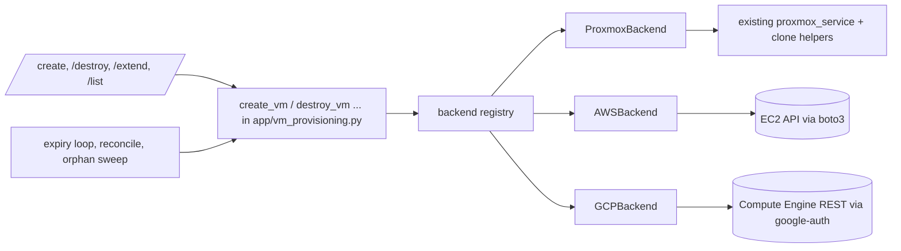
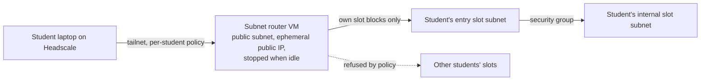

# Multi-backend lab VMs: Proxmox, AWS and Google Cloud

Status: draft for instructor review, 2026-11-04. Branch `feature/multi-backend-vms`.

## Intent

Today every lab VM is a Proxmox clone. The instructor wants AWS and Google
Cloud as alternative places to run the same labs, chosen **per machine**, so
that most ENPM634 labs can eventually run on whichever platform suits a given
term, class size or budget. Cost matters more than anything else after
correctness: labs are spun up for a session and torn down afterwards, never run
24/7, and nothing a student used may keep billing after the student is done.

## Decisions made by the instructor

| Topic | Decision |
|---|---|
| How a machine picks its backend | In `templates.yaml`, per machine. A deployment group sets a default; a machine may override it. The file is already re-read on every request, so a change applies to the next deployment without a restart. |
| Mixed-platform labs | Not allowed. Every machine of one deployment must resolve to the same backend; the portal refuses a mixed group. |
| Branch scope | The backend abstraction, Proxmox moved behind it with no behaviour change, plus AWS and GCP backends, with fake-based tests written first and opt-in live contract tests. Building cloud images and porting ENPM634 labs are follow-up plans. |
| Student access | Not on the public internet, and as cheap as possible. One VPC per cloud is acceptable (see "Networking"). |
| Cleanup | When a student is done, everything created for that student's lab is removed, whatever the backend. |
| Cost | Labs are not on 24/7. Standing cost must scale to (near) zero between sessions. |
| VPN | A student must reach only their own labs, on every backend. A separate VPN per backend was offered as one option; a Headscale-native per-student policy was preferred if feasible (see "Networking"). |

## Goals

1. One entry point, `create_vm`, that dispatches to the machine's backend;
   destroy, extend, status, IP discovery, expiry, reconcile and orphan sweep
   dispatch on the backend stored with each VM record.
2. Proxmox behaviour is unchanged. The production `templates.yaml` keeps
   working byte-for-byte, and the existing suite (1117 passed, 5 skipped at
   `bd75a88`) stays green, with only patch-point updates where a test patched
   a name that moved.
3. AWS and GCP backends that launch a machine from a prebuilt image, report its
   private IP, extend its expiry, and destroy it, with the same safety rules the
   Proxmox path follows: never retire a record on a failed call, identity is
   verified before destroy, and absence needs positive evidence.
4. Every resource the portal creates for a student's lab is removed when the
   lab ends, on every path: student destroy, admin destroy, expiry, failed
   deployment, and leaked resources found by the sweeper.
5. Standing cost between sessions is limited to stopped disks.
6. A student on the VPN reaches only their own (and their groups') lab
   machines, on every backend, and lab machines of different students cannot
   reach each other.

## Non-goals

- Building AMIs or GCE images (a later Packer plan). Operators supply image IDs.
- Porting ENPM634 labs (a later plan, per lab).
- King of the Hill on cloud backends. KOTH relies on the Proxmox guest agent to
  read claim files; a KOTH group whose machines resolve to a cloud backend is
  refused at validation.
- Provisioning the VPC, subnets, router VM or IAM with Terraform. The operator
  creates them once by following `docs/CLOUD_BACKENDS.md`; the portal only
  creates and deletes per-deployment resources inside them.
- Spot or preemptible instances, multi-region placement, autoscaling groups.
- Mixed-backend deployments.

## Anti-goals (a technically working result that would still be a failure)

- Any per-student resource that survives the student's lab and keeps billing:
  an instance, a disk, a security group, a firewall rule, a public IP.
- A lab VM with a public IP, or one that can reach the internet.
- A VPN credential stored on a lab VM that students can get root on.
- A standing NAT gateway, load balancer or always-running VM per lab.
- A cloud SDK call that blocks the single gevent worker (see "Runtime").
- A record retired because a cloud API call failed or timed out.

## Architecture



### The backend interface

`app/backends/base.py` defines a `VMBackend` protocol and plain dataclasses.
The names below are the contract; signatures are finalized in the plan.

| Operation | Purpose | Proxmox | AWS | GCP |
|---|---|---|---|---|
| `admit(spec, reservation_id)` | capacity check and reservation | existing `select_best_node` (node memory, thresholds) | max-concurrent-VM cap | max-concurrent-VM cap |
| `create(spec)` | launch and start one machine | clone + NIC/VLAN config + start (existing helpers) | `RunInstances` from AMI | `instances.insert` from image |
| `inspect(record)` | identity check before destroy | existing `inspect_vm_guest` | describe by instance id, verify tags | get by name/zone, verify labels |
| `destroy(record)` | stop and delete | existing stop + delete with task waits | `TerminateInstances` and wait | `instances.delete` and wait |
| `confirm_absent(record, error)` | positive evidence of absence | existing `confirm_proxmox_absence` | `InvalidInstanceID.NotFound`, or state `terminated` | HTTP 404 on get |
| `ip_addresses(record)` | what `/list` shows | guest agent (existing, `10.` filter) | private IP from describe | `networkIP` from get |
| `set_expiry(record, expires_at)` | extend | `Expires:` description (existing) | `lab-playground-expires` tag | `lab-playground-expires` label |
| `list_managed()` | inventory for reconcile and orphan sweep | existing cluster index | tag-filtered describe | label-filtered list |
| `cleanup_deployment(deployment_id)` | delete per-deployment network resources once the last machine is gone | no-op | delete the deployment's security group | delete the deployment's firewall rule |
| `ensure_slot(slot)` / `release_slot(slot)` | create on first use / delete when unused, a student's or group's slot network | no-op (VLANs are static) | the slot subnet | the slot subnetwork |

`ProxmoxBackend` is an adapter over the existing, proven functions in
`app/proxmox_service.py` and the clone helpers in `app/routes/vm_creation.py`.
It does not reimplement them, so the incidents those functions encode (the
HTTP-500 "does not exist" ambiguity, stale inventory, UPID waits) keep their
fixes and their tests.

**Destroy policy is a parameter, not a convergence.** Today the four destroy
paths deliberately differ for Proxmox: student destroy forces deletion of a
guest with a corrupt config (`app/routes/vm_lifecycle.py`), expiry refuses to
delete when the stop fails (`app/tasks.py`), and failed-deploy cleanup and
admin bulk destroy attempt deletion despite a stop error
(`app/routes/vm_creation.py`, `app/routes/admin.py`). `destroy(record, policy)`
takes a `DestroyPolicy` (`STRICT` for expiry, `BEST_EFFORT` for admin bulk and
failed deploy, `FORCE_CORRUPT` for student destroy), and `ProxmoxBackend` maps
each to the code path that runs today. AWS and GCP terminate in one call with
no separate stop, so every policy behaves the same there.

All four paths, and reconcile and the orphan sweep, move onto the backend
calls; none keeps a private Proxmox call chain.

The registry (`app/backends/__init__.py`) builds only backends listed in
`ENABLED_BACKENDS` and hands out one instance per process.

### Choosing the backend

Resolution order for a machine: the machine's `backend:` key, then the
deployment group's `backend:` key, then `proxmox`. After resolution, all
machines in a group must agree; a disagreement, an unknown name, or a backend
that is not in `ENABLED_BACKENDS` is a validation error shown to the admin and
refused at `/create`. The stored `VMRecord.backend` decides every later
operation, so changing the YAML never affects running machines.

### Template schema

Existing top-level Proxmox keys stay valid and mean the same thing. New keys
are additive (unknown keys already only warn):

```yaml
deployment_groups:
  - display_name: "Web Exploitation Lab"
    backend: aws                    # default for this group; omitted = proxmox
    uptime_minutes: 240
    templates:
      - name: "attacker"
        entry_point: true
        memory: 4096                # used by Proxmox; informational for cloud
        cores: 2
        connect: {protocol: ssh, port: 22, username: student}
        # Proxmox keys, unchanged (may also be nested under `proxmox:`)
        type: qemu
        template_locations: {node1: 7101}
        storage_locations: {node1: local-zfs}
        aws:
          image_id: ami-0123456789abcdef0
          instance_type: t3.medium
          disk_gb: 30
        gcp:
          image: projects/example-project/global/images/attacker-2026
          machine_type: e2-medium
          disk_gb: 30
```

A machine carries a block for every backend it can run on; `backend:` picks
which one is used. Cloud machine sizes are explicit (`instance_type`,
`machine_type`) so that cost is visible in the file rather than derived.

### Data model

`vm_records` gains four columns, added by an idempotent
`scripts/migrate_add_vm_backend.py`:

- `backend VARCHAR(32) NOT NULL DEFAULT 'proxmox'`
- `provider_id VARCHAR(255) NULL`: the EC2 instance id or GCE instance name.
  NULL for Proxmox, where `vmid` is the provider identity.
- `deployment_id VARCHAR(64) NULL, indexed`: one value per `deploy_bundle`
  run, shared by every machine it launched. It is the bundle's existing VMID
  reservation id (already a fresh `uuid4().hex` per run), so "is this
  deployment still being created?" is answered by the existing
  `vmid_reservations` table, and "is this its last live machine?" by a query
  on live records with that id. A redeployment of the same lab gets a new id,
  so cleanup of the old run can never delete the new run's security group or
  firewall rule. Existing rows stay NULL; NULL means "no per-deployment cloud
  resources".
- `network_slot INT NULL`: the VLAN tag (slot) the machine was placed in. On
  Proxmox it records the tag already used for its NIC; on the clouds it names
  the slot subnet, so "is this slot still in use?" is a query. Existing rows
  stay NULL.

`vmid` stays a unique integer allocated by the portal for **every** backend.
For a cloud machine it is a portal identity rather than a hypervisor one. This
keeps `vm_lifecycle_lock(vmid)`, VMID reservations, alerts and the outbox
unchanged. The allocator currently requires a Proxmox client
(`get_next_available_vmid(proxmox, ...)`); when Proxmox is not enabled it uses
the database high-water mark and reservations alone. `node` holds the AWS
availability zone or GCE zone for cloud machines; `vm_type` is `qemu`/`lxc`
for Proxmox and `aws`/`gcp` for cloud machines.

### Provider names

`vm_name` (shown to students, 255 characters, reused on relaunch) is
unchanged. The provider-side name is separate, short and unique per site:

- GCE instance: `lp-<site>-<vmid>`, lower-cased, at most 63 characters,
  matching `[a-z]([-a-z0-9]*[a-z0-9])?`. `LAB_SITE_ID` is therefore restricted
  to 1–20 characters of `[a-z0-9-]`, validated at startup.
- AWS: the instance id is the identity; the `Name` tag carries `vm_name` for
  the console.
- Security group (AWS) and firewall rule plus network tag (GCP):
  `lp-<site>-d-<first 16 hex of deployment_id>`.

Cloud orphan detection uses the site tag or the name prefix `lp-<site>-`,
never the `student-`/`group-` prefixes, so staging and production in one
account or project cannot see each other's resources.

Untracked-survivor entries (`data/untracked-survivors.jsonl`) gain `backend`,
`provider_id` and `deployment_id`; an entry without them is read as Proxmox, so
files written by the current release still import.

## Lifecycle and cleanup

The cleanup guarantee rests on three layers, applied on every backend:

1. **The normal path deletes everything it created.** Destroying a machine
   deletes its instance. Boot disks are created with `DeleteOnTermination`
   (AWS) and `autoDelete` (GCP), so no separate disk delete exists to forget.
   Lab machines never get a public IP, so no IP is left to release. When the
   last live record of a deployment is retired, the deployment's security
   group (AWS) or firewall rule (GCP) is deleted; when the last live record in
   a slot on a cloud backend is retired, that slot's subnet is deleted too.
2. **Every cloud resource is tagged.** Instances get the AWS tags or GCP
   labels `lab-playground-site=<LAB_SITE_ID>`, `lab-playground-vmid`,
   `lab-playground-deployment=<deployment_id>` and
   `lab-playground-expires=<epoch seconds>` (the one canonical expiry key).
   AWS security groups carry the same site and deployment tags. GCP firewall
   rules cannot carry labels, so their ownership is their name
   (`lp-<site>-d-<id>`), their target tag (same string) and their
   `creationTimestamp`; the sweeper reads those. `LAB_SITE_ID` keeps two
   portals (staging and production) sharing one cloud account from touching
   each other's resources.
3. **The sweeper finds what leaked.** The orphan reaper becomes
   backend-generic. Per enabled backend, it lists managed resources with this
   site's tag and removes:
   - instances with no live `VMRecord`, no live reservation, and an expiry past
     the grace period (the same rule Proxmox follows today);
   - security groups or firewall rules whose deployment has no live records,
     no live VMID reservation and no remaining instance, and which are older
     than the grace period.

   The existing dry-run switch, per-pass time and item budgets, and
   positive-evidence rules apply unchanged. **An instance that has a live
   `VMRecord` is never swept**, whatever its expiry tag says. The database is
   the canonical expiry: extend commits the new `expires_at` and then updates
   the provider tag best-effort, exactly as Proxmox treats its `Expires:`
   description today. A stale tag matters only after the record itself is
   gone, and then the older value only makes cleanup sooner.

Path by path:

| Path | What happens |
|---|---|
| Student or admin destroy | Under `vm_lifecycle_lock(vmid)`: `inspect` must return match (absent retires the record); `destroy(record, policy)`; mark the record destroyed; if no live record with its `deployment_id` remains, `cleanup_deployment`. |
| Expiry | The expiry loop already destroys expired records; it now dispatches on `record.backend` with `STRICT`, and deletion retries and alerts work as today. The deployment cleanup follows the last record, as above. |
| Failed deployment | `_finalize_failed_deployment` already sweeps by name prefix and records survivors durably. It dispatches per backend, and calls `cleanup_deployment` once every launched machine is confirmed gone; otherwise the sweeper removes the group after the survivors are reaped. |
| Crash between launch and commit | The machine is tagged before or at launch (AWS `TagSpecifications`, GCP labels in the insert), so the sweeper can see it from its first second. |
| Database outage during cleanup | The untracked-survivors file, as today, now carrying `backend` and `provider_id`. |
| Machine deleted by hand in the console | Reconcile retires the record after two absent sightings `ORPHAN_CONFIRM_SECONDS` apart, as for Proxmox, and raises the existing admin alert. |

Create is idempotent against retries: AWS `ClientToken` and the GCP
`requestId` are derived from the VMID reservation, so a retried call cannot
launch a second machine.

## Networking and student access

### The access model this replaces

As documented in `docs/JUMPBOX.md` and `config/headscale-acl.example.json`:

- The jumpbox advertises `10.0.0.0/8` (NoSNAT, stateful filtering off) and is
  the gateway for every lab VLAN; nothing in the documented setup filters
  traffic it forwards between VLANs.
- The example policy lets `autogroup:member` reach the whole advertised range.
- So in the documented setup any VPN member can reach every lab VM, and lab
  VMs on different VLANs can reach each other through the jumpbox.
- Hosts that run Docker (the jumpbox may) own `172.17.0.0/16`, so no lab range
  may use it.

Adding clouds behind the same rule would copy that exposure to them. This
design closes it for **all three backends**.

### Why not one VPN per backend

A separate Headscale per backend would separate AWS from GCP from Proxmox, but
not students from each other: inside each VPN every student would still reach
every lab on that backend. It would also triple key distribution and term
changeover. Headscale can enforce per-student access itself, and it does so at
each subnet router, which is where every lab packet enters. So there stays
**one VPN and one key per student**, with a per-student policy.

### Network slots: one address block per student or group, on every backend

Every user and every group already owns two unique VLAN tags (entry and
internal, pools 100–500, `app/vlan_allocator.py`). A tag is the identity of a
**network slot**, and each backend maps a slot to an address block
deterministically:

| Backend | Slot T → block | Source of truth |
|---|---|---|
| Proxmox | the jumpbox's existing VLAN bands, e.g. entry T → `10.T.0.0/24` | `JUMPBOX_VLAN_BANDS` and `scripts/jumpbox_netgen.py` |
| AWS | `AWS_LAB_CIDR` (default `172.20.0.0/16`) + T × 64, a `/26` | `app/backends/network_slots.py` |
| GCP | `GCP_LAB_CIDR` (default `172.21.0.0/16`) + T × 64, a `/26` | same module |

On the clouds, a slot is a subnet (AWS) or subnetwork (GCP) inside the one
shared VPC, named `lp-<site>-s-<T>`. It is created on first use by a
deployment that needs it, and deleted when no live record and no live
reservation uses it any more (the per-student cleanup rule applies to it, and
the sweeper removes leaked ones). Subnets cost nothing. A `/26` holds 59
usable AWS addresses, far more than one deployment launches. AWS's default
limit of 200 subnets per VPC covers roughly 100 students and groups with
entry and internal slots in use at once; the runbook asks for an increase
for larger classes.

Machine placement matches Proxmox: an entry-point machine goes in the owner's
entry slot, every other machine in the owner's internal slot. A group
deployment uses the group's two slots.

### The per-student VPN policy

`scripts/headscale_policy.py` renders the complete Headscale policy from the
portal database plus the operator's base file (`config/headscale-acl.json`,
which keeps `groups`, `tagOwners` and `hosts`):

- `group:staff` reaches everything, as now.
- Each student (the Headscale user is the portal login, as created by
  `scripts/headscale_term_changeover.sh`) reaches only **their own slots' blocks
  on every backend, plus those of each group they belong to**. Which slot
  kinds a student reaches directly is taken from one source,
  `JUMPBOX_VLAN_BANDS`: today those are user entry, group entry and group
  internal, and not user internal, which the jumpbox does not route. The same
  kinds are granted on the clouds, so a lab behaves the same on every backend.
  On Proxmox a student's reachable set shrinks from "everyone's" to "their
  own" and nothing else changes.
- **Reverse shells:** each student's blocks may open connections to that
  student's own devices (`<login>@:*`) and to no one else's.
- The blanket `autogroup:member` rule is removed.

The script is dry-run by default and prints the diff against the policy in
force (`headscale policy get`). `--apply` validates with `headscale policy
check`, keeps a timestamped backup of `/etc/headscale/acl.json`, installs the
new file and makes Headscale load it, then reads the policy back. It runs at
term changeover (`scripts/term_changeover.sh` calls it) and after group
changes. Until it is re-run, a new group's members are refused rather than
let in: the failure is closed.

Whether Headscale in `policy.mode: file` picks up a new file without a
restart depends on its version; the apply step checks, on first live use,
whether the policy read back after install matches, and restarts the
container if it does not. That is an open item for live acceptance, not a
design assumption.

### Lateral isolation between labs

The VPN policy controls what a student's laptop can reach. Lab machines
reaching *other students'* lab machines is a separate path:

- **Proxmox:** `scripts/jumpbox_configure.sh` gains `--isolate-vlans`. It
  generates (through `jumpbox_netgen.py`) an nftables forward table that drops
  traffic routed between two lab VLAN interfaces and leaves tailnet↔VLAN
  traffic alone, which the Headscale policy already governs. Same-VLAN traffic
  never crosses the jumpbox and is unaffected. A group's entry and internal
  networks are joined by the entry machine's second NIC (`internal_nic`), not
  by jumpbox routing, so groups keep working. It is dry-run by default like
  `--ssh-staff-only`. **Applying it to the live jumpbox is an instructor step
  after this branch merges, not part of the branch.**
- **AWS and GCP:** per-deployment security groups and firewall rules. Machines
  of one deployment may talk to each other, accept traffic from the tailnet
  range (`100.64.0.0/10`, already narrowed per student by the VPN policy) and
  nothing else.

### The cloud network



- **One VPC per cloud, shared by all students.** A VPC costs nothing on
  either cloud. It holds a small public subnet for the router and the slot
  subnets, which have no route to the internet (no NAT).
- **One subnet router per cloud**, the cloud equivalent of the jumpbox. It joins
  Headscale with `tag:jumpbox` and advertises the whole `AWS_LAB_CIDR` or
  `GCP_LAB_CIDR`; the per-student policy narrows what each student may use. It
  runs with `--snat-subnet-routes=false`, as the jumpbox does, so lab machines
  see each student's tailnet address and reverse shells work. That needs a
  route for `100.64.0.0/10` through the router on the slot subnets (AWS: an
  entry in the main route table to the router's network interface, with the
  source/destination check off; GCP: a route with the router as next hop and
  `canIpForward`). Its SSH is closed the same way as the jumpbox's: the
  security group or firewall rule allows SSH only from the staff addresses.
- **No internet from lab machines.** Images are prebuilt with everything the
  lab needs. This is also the right containment for attack labs.
- `/list` shows the machine's private IP. Cloud backends return it from the
  API, so the guest agent and the `10.` prefix filter remain Proxmox-only.

### Router lifecycle: scale to zero

The router is the only shared cloud machine, and it runs only while that cloud
has labs:

- Before the first launch on a backend, `admit` makes sure the router is
  running (start it, wait for `running`). This adds roughly a minute to the
  first deployment of a session, an estimate to measure in live acceptance.
- The expiry loop stops the router after `<BACKEND>_ROUTER_IDLE_MINUTES`
  (default 30) with no live records and no live reservations on that backend.
- **Router start and stop are serialized by a dedicated lifecycle lock**,
  `vm_lifecycle_lock` on a reserved negative key per backend (`-1` AWS, `-2`
  GCP). It is held across the "is it idle?" check and the stop call, and
  across a launch's "make sure it is running" call, so a stop can never land
  between a launch's start and its machine creation. The short admission
  transaction is not used for this, because it must not stay open across a
  one-minute provider waiter; the lifecycle lock already falls back to a
  process lock and becomes a MySQL named lock with `DISTRIBUTED_VM_LOCKS`.
- The router uses an ephemeral public IP, which is released on stop on both
  clouds, so a stopped router costs only its disk.

## Cost model

On-demand US list prices, verified 2026-11-04 for IPv4 and NAT; the instance
prices are list prices to re-check for the operator's region before relying on
them.

| Item | While a session runs | Between sessions |
|---|---|---|
| VPC, subnets, security groups, firewall rules, routes | free | free |
| Router, AWS `t4g.nano` plus public IPv4 | about $0.009/h | 8 GB gp3 disk, about $0.64/month |
| Router, GCP `e2-micro` plus external IPv4 | about $0.013/h (e2-micro is free-tier eligible in some US regions) | 10 GB disk, about $0.40/month |
| NAT gateway | **not used** (AWS would be $0.045/h plus $0.045/GB, about $33/month standing) | none |
| Lab machine, e.g. AWS `t3.medium` | about $0.042/h each | none (deleted) |
| Lab machine, e.g. GCP `e2-medium` | about $0.034/h each | none (deleted) |
| Lab disk, 30 GB | about $0.003/h each | none (deleted with the instance) |

Worked example: 90 students with one `t3.medium` machine each, for a 4-hour
session, costs about 90 × 4 × ($0.042 + $0.003) ≈ **$16** on AWS, or about
**$13** on GCP with `e2-medium`, plus a few cents for the router. Windows images
on AWS add the Windows license to the hourly rate.

Guardrails:

- `AWS_MAX_VMS` / `GCP_MAX_VMS` are required when the backend is enabled (no
  unlimited default). `admit` counts live records plus pending reservations
  under the admission lock and refuses past the cap.
- `uptime_minutes` and expiry already bound how long any machine lives.
- New cloud accounts have low vCPU quotas (a few vCPUs); the docs tell the
  operator to request an increase sized to the class before the first session.

## Configuration and credentials

- `ENABLED_BACKENDS`, default `proxmox`, so existing deployments are unchanged.
  `validate_config()` (`app/config.py`) currently requires `PROXMOX_HOST` and
  credentials unconditionally; it will require them only when `proxmox` is
  enabled, so a cloud-only portal can start.
- `LAB_SITE_ID` (required when a cloud backend is enabled): the value of the
  ownership tag, 1–20 characters of `[a-z0-9-]`.
- `/create` checks the user's Proxmox VLAN assignment before anything else
  (`app/routes/vm_creation.py`). That check moves after backend resolution
  and applies only to Proxmox deployments; cloud deployments use no VLANs.
- AWS: `AWS_REGION`, `AWS_LAB_VPC_ID`, `AWS_LAB_CIDR` (default
  `172.20.0.0/16`, inside the VPC's CIDR), `AWS_ROUTER_INSTANCE_ID`,
  `AWS_MAX_VMS`, `AWS_ROUTER_IDLE_MINUTES`.
  Credentials come from boto3's standard chain (environment, shared config,
  or an instance role); nothing new is stored by the portal.
- GCP: `GCP_PROJECT`, `GCP_REGION`, `GCP_ZONE`, `GCP_NETWORK`, `GCP_LAB_CIDR`
  (default `172.21.0.0/16`), `GCP_ROUTER_INSTANCE`, `GCP_MAX_VMS`,
  `GCP_ROUTER_IDLE_MINUTES`. Credentials come from Application Default
  Credentials (`GOOGLE_APPLICATION_CREDENTIALS` or the metadata server).
- Startup refuses a lab CIDR that overlaps `10.0.0.0/8`, `100.64.0.0/10`,
  `172.17.0.0/16` (Docker's default, present on the jumpbox) or another
  backend's CIDR, or that is too small for slot 500.
- Least-privilege IAM examples ship in `docs/CLOUD_BACKENDS.md`. AWS
  terminate and delete permissions are conditioned on the site tag.
- Real account IDs, VPC IDs, image IDs and project names live only in the
  operator's untracked `.env` and `templates.yaml` (repo rule 13).
  `.env.example` and `templates.example.yaml` get neutral placeholders.

## Runtime constraint

The app runs a single gunicorn gevent worker with `monkey.patch_all()`.

- **AWS uses `boto3`**, whose transport is urllib3 and which works under
  gevent's monkey patching.
- **GCP uses the Compute Engine REST API directly** through
  `google.auth.transport.requests.AuthorizedSession` (a `requests` session),
  not the gRPC-based client libraries. That avoids grpcio under gevent and
  keeps the new dependency to `google-auth`.
- Both new dependencies go through the existing lock workflow (`pyproject.toml`,
  `uv lock`, re-export the hash-pinned `requirements.txt`);
  `tests/test_dependency_lock.py` enforces it.

## Testing

Test-driven throughout: every behaviour starts as a failing test.

- **The Proxmox refactor runs against the existing suite as its safety net.**
  Tests that patch a moved name are updated to the new patch point and do not
  change what they assert.
- **AWS unit tests use `moto`'s `mock_aws`** (dev dependency): a real boto3
  client against an in-process EC2 that keeps state, so tests assert on tags,
  security groups, instance state and disk deletion, not on mock call lists.
- **GCP unit tests use an in-repo fake Compute REST server** (a stateful fake
  `requests` session implementing the handful of endpoints used, operations
  included), modelled on the existing `FakeProxmox`.
- **One shared backend contract suite** is parametrized over all three
  backends' fakes. It pins the same lifecycle (admit, create, inspect, IPs,
  extend, destroy, confirm absent, cleanup of the deployment) and the cleanup
  invariant: after a deployment is destroyed, `list_managed()` returns no
  resource carrying its deployment tag.
- **Opt-in live contract tests** (`LIVE_AWS=1`, `LIVE_GCP=1`), following the
  guards of `tests/live/`: a dedicated site tag, a VM cap of 1, a 30-minute
  expiry tag, teardown that always runs, and post-teardown proof that nothing
  tagged remains. CI never runs them.

## Rollout and compatibility

- A portal with `ENABLED_BACKENDS` unset behaves exactly as v1.0.0, apart from
  the new columns' defaults.
- The migration is idempotent and additive; older code ignores the new columns,
  so a rollback to v1.0.0 still works as long as no cloud records exist.
- The CHANGELOG "Upgrade notes" list the migration and the new variables.

## Left to the builder

- Module boundaries inside `app/backends/`, helper names, dataclass fields
  beyond the operations listed above.
- How the shared create flow (`deploy_bundle`) is split between generic code
  and backend hooks, as long as the Proxmox order (reserve VMIDs, admit, clone
  semaphore, create, renew leases, start, commit, release) is preserved.
- Exact waiter timeouts for cloud launch and termination (bounded, and
  consistent with `VM_LIFECYCLE_LOCK_TIMEOUT_SECONDS`).

## Calls made by the designer (instructor to confirm while reading)

1. The VMID stays the portal identity for cloud machines, with a new string
   `provider_id`, instead of replacing the integer key everywhere.
2. KOTH stays Proxmox-only for now.
3. The router runs without SNAT, so reverse shells reach students, at the cost
   of one route per cloud set up by the operator.
4. Lab machines have no internet access; images must be complete.
5. Cloud network base (VPC, subnets, router, IAM) is operator-provisioned from
   documentation, not Terraform.
6. GCP over raw REST with `google-auth`, not the official client libraries.
7. Cloud machine sizes are explicit in YAML, not derived from `memory`/`cores`.
8. A VM cap per cloud backend is mandatory.
9. One VPN with a per-student Headscale policy, not one VPN per backend. On
   Proxmox this also removes today's any-student-to-any-lab access; applying
   the new policy and `--isolate-vlans` to the live Headscale host and jumpbox
   are instructor steps after merge.
10. `deployment_id` is the bundle's VMID reservation id, persisted on every
    record, so a redeployment never shares cleanup identity with its
    predecessor.
11. Each destroy path keeps its current Proxmox policy through a
    `DestroyPolicy` parameter rather than converging on one behaviour.
